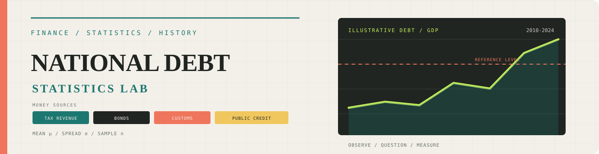

# Project
# 📊 National Debt Investigation

> **Finance × Statistics × History**  
> Exploring how data can explain the financial choices of a young nation.

I am a student who is rarely satisfied with accepting an explanation at face value. When I encounter a question or a problem, I want to examine its roots, understand the forces behind it, and look for evidence-based answers. When I watched the musical *Hamilton* in Form 3, I became curious about the financial system Hamilton helped shape after American independence. I began asking how a country weakened by war, large debts, and fragile public finances could remain economically stable. Could national debt, when managed with credibility and purpose, help a country survive a crisis or influence wider economic and financial development? Those questions led me to this project and strengthened my interest in finance as a future field of study. Statistics is the tool that can help me test ideas, interpret evidence, and develop that curiosity into a more rigorous understanding of the world.

## Contents

- [Project Goals](#project-goals)
- [Topics covered](#topics-covered)

## Project Goals
- **Investigate** the dynamics of national debt.
- **Develop** fundamental quantitative and statistical skills.
- **Demonstrate** my passion for cross-disciplinary economic research.

---

## Topics covered

The project may use these Statistics 1 and quantitative-finance techniques:

- **Descriptive statistics:** mean, median, quartiles, variance, and standard deviation
- **Data distributions:** grouped data, frequency tables, histograms, and skewness
- **Probability:** discrete random variables, standard normal distribution, and z-scores
- **Estimation:** linear interpolation between known data points
- **Relationships and risk:** correlation, regression, and threshold exceedance

Together, these methods can show typical debt levels, financial uncertainty, unusual years, and possible relationships with economic growth.

